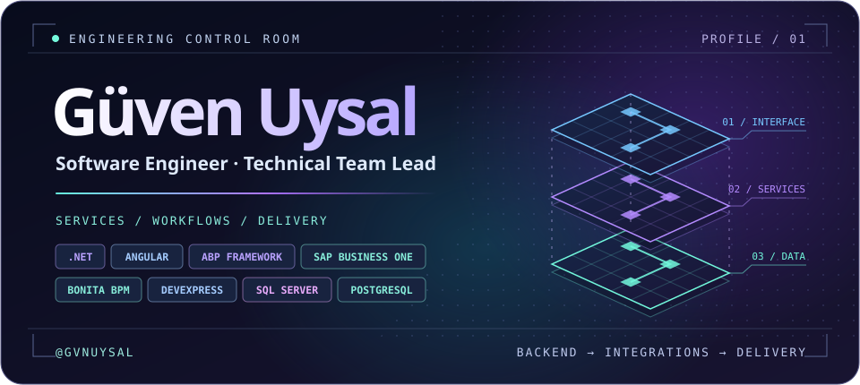
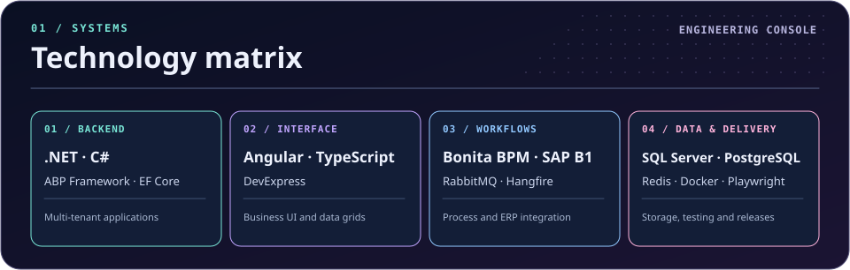
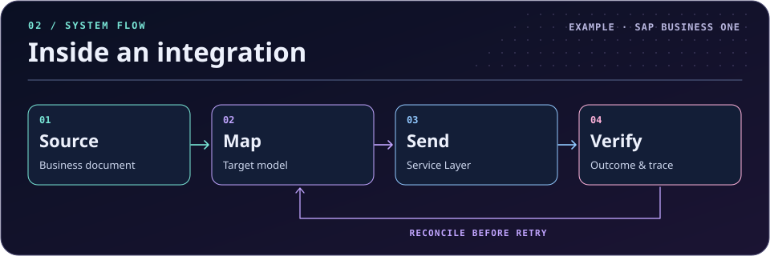
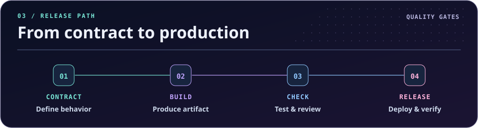

  

<h1 align="center">Güven Uysal</h1>

<strong>Software Engineer · Full-Stack Developer · Technical Team Lead</strong>

  <a href="#technology-matrix">Technology</a> ·
  <a href="#inside-an-integration">Integrations</a> ·
  <a href="#from-contract-to-production">Delivery</a> ·
  <a href="#contact">Contact</a>

I build .NET services, Angular applications, and integrations that connect business systems. I work across the application, from the screen where someone enters an order to the service that validates it and the process that delivers it to the ERP. As a technical team lead, I stay involved in the code, architecture decisions, reviews, and releases.

> **A question I ask in reviews:** If this operation fails halfway through, how will the next person know what happened and whether it is safe to try again?

## Technology matrix

  

| Area | What I work on | Tools |
| :--- | :--- | :--- |
| **Backend and architecture** | REST APIs, multi-tenant applications, domain boundaries, and data access | C# · .NET · ABP Framework · EF Core |
| **Frontend** | Business applications, operational dashboards, data grids, and form workflows | Angular · TypeScript · DevExpress |
| **Business processes** | Process modeling, workflow automation, and background work | Bonita BPM · Hangfire · RabbitMQ |
| **ERP integrations** | Master data and document flows across company databases | SAP Business One Service Layer · REST |
| **Data** | SQL queries, indexes, provider-specific migrations, and caching | SQL Server · PostgreSQL · Redis |
| **Engineering delivery** | API tests, build pipelines, and repeatable deployments | Playwright · Docker · Azure · Bitbucket Pipelines · IIS |

## Inside an integration

  

An integration has to answer what happened to each document. In a SAP Business One flow, I look at how the source is identified, how company-specific fields are mapped, how the destination result is recorded, and what the operator sees if processing stops halfway.

- **Company-to-company flows.** Map business partners, items, and documents across databases while keeping source references available for reconciliation.
- **Session and retry handling.** Keep sessions scoped to the right company. Refresh an expired session and check ambiguous write outcomes before retrying.
- **Workflows and background work.** Model steps and handoffs in Bonita BPM. Use queues or scheduled jobs when work needs to continue outside the original request.
- **Operational visibility.** Make the document ID, target company, processing stage, and failure reason available when investigating a problem.

## From contract to production

  

| Stage | What I want the team to be able to answer |
| :--- | :--- |
| **Contract** | What does the feature promise? Who owns validation, data, and failure handling? |
| **Build** | Can the same source and inputs produce the same release artifact? |
| **Check** | Have we exercised the important API paths, migrations, and integration failure cases? |
| **Release** | Can another engineer deploy the artifact, verify the result, and diagnose a failed rollout? |

<strong>Engineering notes · Data changes across two providers</strong>

SQL Server and PostgreSQL can differ in generated SQL, index filters, collation, and schema behavior. I keep provider-specific migrations explicit and inspect the generated SQL for the target database before rollout.

<strong>Engineering notes · Business screens people use all day</strong>

In Angular and DevExpress screens, I focus on predictable editing, filters that match how users work, and error messages that tell people what they can do next. A good grid keeps the user oriented while they sort, group, or edit real business data.

<strong>Engineering notes · Leading while staying hands-on</strong>

I use reviews and design discussions to make decisions visible to the team. For recurring work, I try to leave behind shared checks, deployment steps, and examples that another engineer can run without relying on my local setup.

## Contact

  <strong>Güven Uysal</strong> 
  <a href="https://www.linkedin.com/in/gvnuysal/">LinkedIn ↗</a> ·
  <a href="mailto:gvnuysal@gmail.com">Email ↗</a>

